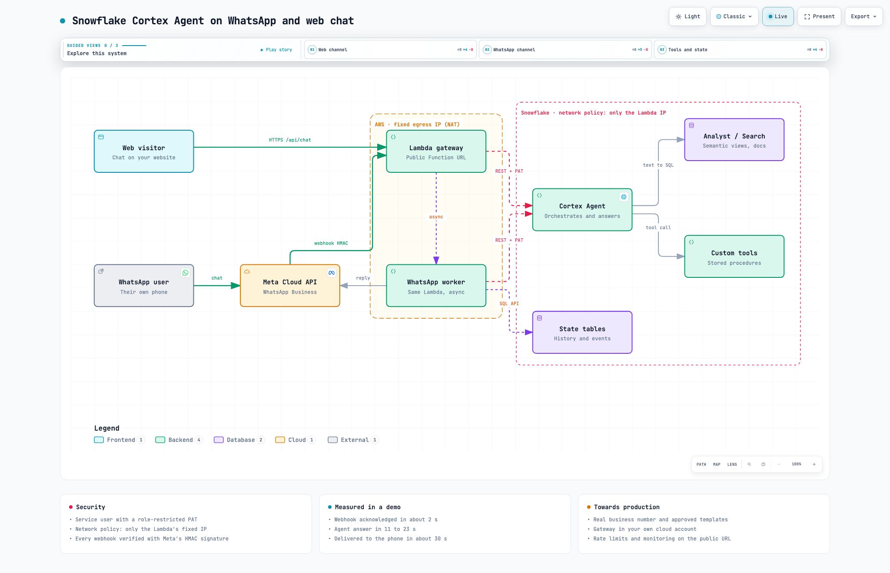

# Snowflake Cortex Agent on WhatsApp and web chat

Put a [Snowflake Cortex Agent](https://docs.snowflake.com/en/user-guide/snowflake-cortex/cortex-agents) in front of
your customers on **WhatsApp** and on a **public web chat**, with the agent, its data and the conversation history
staying in Snowflake. A small AWS Lambda acts as the gateway between the public channels and the agent.



The interactive version of the diagram (guided views per channel, animated flows, presentation mode) is
[`docs/architecture.html`](docs/architecture.html): download it and open it in a browser.

This repository contains:

- this README: architecture, components, security model and limitations;
- a **Cortex Code skill** (`skills/cortex-agent-whatsapp`) that walks you through deploying it in your own
  Snowflake and AWS accounts, including the Meta developer app setup.

## Why a gateway is needed

Snowflake endpoints (the Cortex Agents REST API, Snowpark Container Services and Snowflake App Runtime ingress)
always require Snowflake authentication: a PAT, a key-pair JWT or an OAuth token. WhatsApp webhooks cannot send
that. Meta calls your webhook with its own HMAC signature (`X-Hub-Signature-256`) and expects a fast `200`.
Twilio is in the same position with `X-Twilio-Signature`.

So something public has to:

1. receive the webhook and verify the provider's signature,
2. answer the provider immediately,
3. call the Cortex Agent outbound with a Snowflake credential,
4. send the answer back through the provider's API.

That is the Lambda. It holds no business logic: the agent, its tools, the data and the history all live in
Snowflake.

## How it works

### Web chat (synchronous)

1. The visitor types in the chat page served by the Lambda (`GET /`).
2. The page posts to `POST /api/chat`. The gateway issues an unguessable session id on the first turn and ignores
   any id it did not issue.
3. The gateway loads the last turns of that session from `CONVERSATION_MESSAGES` (SQL API), adds a context line
   (`[channel=web; today=2026-11-09 (Monday)]`) and calls the agent:
   `POST /api/v2/databases/{db}/schemas/{schema}/agents/{name}:run` with `stream: false`.
4. The agent orchestrates its tools (Cortex Analyst over a semantic view, Cortex Search, stored procedures) and
   answers. The gateway stores both turns and returns the answer in the same HTTP response.

### WhatsApp (asynchronous)

1. The user writes to the business number. Meta posts the event to `POST /whatsapp`.
2. The gateway verifies the HMAC signature with the Meta app secret, records the event in `WA_EVENTS`, skips
   Meta retries of a message it already accepted, and **re-invokes itself asynchronously**. It answers Meta with
   `200` in about 2 seconds, well inside Meta's timeout, even though the agent takes longer.
3. The async worker marks the message as read with a typing indicator, runs the same conversation logic as the
   web chat (history keyed by the user's phone number), converts Markdown to WhatsApp formatting, splits long
   answers and sends them with the Graph API (`POST /{phone-number-id}/messages`).
4. Meta reports `sent`, `delivered`, `read` or `failed` back through the same webhook; the gateway logs them in
   `WA_EVENTS`.

The webhook verification handshake (`GET /whatsapp` with `hub.challenge`) is answered only when the verify token
matches.

### Measured in a working demo

| Step | Time |
|---|---|
| Webhook acknowledged to Meta | ~2 s |
| Cortex Agent answer (Cortex Analyst + a booking procedure) | 11 to 23 s per turn |
| Message delivered to the phone | ~30 s after sending |

## Components

| Component | What it does |
|---|---|
| **Cortex Agent** | Your agent. Any existing agent works; the skill can also create one over a semantic view. Keep it scoped to your business (see limitations). |
| **Agent tools** | Cortex Analyst (semantic views), Cortex Search, and custom tools implemented as stored procedures (for example, booking an appointment and emailing the sales team with `SYSTEM$SEND_EMAIL`). |
| **Service user + role** | `TYPE=SERVICE` user with a least-privilege role: USAGE on the agent and on each tool's objects, and SELECT/INSERT on the state tables. |
| **PAT** | Role-restricted programmatic access token used by the Lambda. Stored only in AWS Secrets Manager. |
| **Network policy** | User-level policy on the service user that only allows the Lambda's fixed egress IP. Snowflake requires a network policy for service users that use PATs, and a user-level policy overrides any account-level policy for that user only. |
| **State tables** | `CONVERSATION_MESSAGES` (history per channel and session) and `WA_EVENTS` (inbound, outbound, delivery status, errors). The gateway owns history so it can bind it to the phone number or server-issued session. |
| **AWS Lambda gateway** | Python 3.12, standard library plus boto3. Public Function URL, routes for WhatsApp and web, async self-invoke for WhatsApp, reserved concurrency as a cost and abuse cap. |
| **NAT gateway / fixed egress** | The Lambda runs in private subnets behind a NAT (or corporate egress) so Snowflake always sees the same IP. Without a VPC the egress IP changes on cold starts and the network policy would block it. |
| **AWS Secrets Manager** | Snowflake PAT, Meta app secret, WhatsApp system user token, verify token. |
| **Meta developer app** | WhatsApp Cloud API: business number (a free test number for demos), webhook subscription, system user token. |

## Security model

- **Inbound to the gateway:** WhatsApp events are accepted only with a valid HMAC signature from your Meta app.
  The web chat is public and anonymous by design. Disable it with `ENABLE_WEB=false` if you only need WhatsApp.
- **Gateway to Snowflake:** one service user, one role-restricted PAT, and a network policy that only allows the
  Lambda's egress IP. A leaked PAT does not work from anywhere else.
- **Least privilege:** the bot role can run the agent and its tools and write two state tables, nothing else.
  The agent runs with the caller's privileges, so it cannot read anything the role cannot read.
- **Sessions:** web session ids are issued by the server (`secrets.token_urlsafe`), and WhatsApp history is keyed
  by the phone number Meta reports. A client cannot read another user's conversation by guessing an id.
- **Internal jobs:** the async worker and the egress check are Lambda invoke payloads, not HTTP routes. Requests
  through the Function URL always arrive as HTTP events, and the public `lambda:InvokeFunction` permission is
  conditioned on `lambda:InvokedViaFunctionUrl`, so only principals in your own AWS account with invoke rights
  (and the function itself) can start them.
- **Secrets** live in AWS Secrets Manager, never in environment variables or in this repository.

## Try it for free with a Meta developer app

You can run the whole thing without paying Meta, using the **test number** every WhatsApp developer app gets. This
is how the demo behind this repository was built. What you need:

- a Meta developer account and a business portfolio (free);
- an AWS account where you can create a Lambda, an IAM role and a secret, with a fixed egress IP (a NAT gateway
  costs roughly USD 35 per month while it exists);
- a Snowflake account with a Cortex Agent, or a semantic view to build one on.

**Limitations of the free test number**

| Limitation | Impact |
|---|---|
| At most **5 allowed recipient numbers**, each verified with a code sent to that phone | Only people you add can get replies. Anyone else's message reaches the webhook, but the reply fails (error 131030). You cannot hand out a QR code to a room. |
| The business number is a Meta-owned **+1 555** number named "Test Number" | No custom display name or profile. |
| **24-hour customer service window** | You can send free-form messages only within 24 hours of the user's last message. Replies to the user are always inside the window; proactive messages (reminders, notifications) need approved templates. |
| **System user token expiry** (for example 60 days) | When it expires the bot silently stops replying. Note the date and rotate it. |
| **Meta's policy on AI chatbots** | Since 2026-01-15 the WhatsApp Business Solution terms do not allow general-purpose AI assistants. Business-scoped bots (catalog, orders, bookings, support) are allowed, so keep the agent's instructions scoped. |
| WhatsApp Web works for the demo | If your own phone is an allowed recipient, open `web.whatsapp.com/send?phone=<test number>` on the presenter's laptop and chat live on the big screen. |

**Moving off the test number** means registering a real phone number on the WhatsApp Business Account. The number
must be able to receive an SMS or voice call, and must not be active on the WhatsApp or WhatsApp Business app (or
you must use Meta's coexistence onboarding for Business app numbers). You also need an approved display name, and
business verification to raise messaging limits. The gateway code does not change: only the phone number id in
the secret.

**Limitations of this solution**

- Text messages and interactive replies only. Audio, images and documents get a polite "text only" reply.
- No streaming: users wait for the full agent answer (typing indicator on WhatsApp, animated dots on the web).
- History is the last 12 turns within 24 hours per session. Users can type `reset` to start over.
- The web chat is anonymous: anyone with the URL spends Cortex credits. Use reserved concurrency, add rate limiting
  or authentication in front for anything beyond a demo.
- PATs expire (the skill uses 30 days). Rotation is a manual step today.

## Meta Cloud API or Twilio?

Both reach the same WhatsApp network and both need this gateway, because neither can send Snowflake credentials
on a webhook. The difference is who you contract with and what comes around WhatsApp.

| | Meta WhatsApp Cloud API (direct) | Twilio (a WhatsApp Business Solution Provider) |
|---|---|---|
| Cost | Meta's per-message pricing only | Meta's pricing plus Twilio's per-message fee |
| Free testing | Test number, up to 5 verified recipients, free-form replies | Trial accounts can only send pre-approved templates to 5 verified numbers. The shared WhatsApp Sandbox (anyone joins with a `join <code>` message, 72-hour sessions) needs an upgraded account |
| Channels | WhatsApp only | WhatsApp, SMS, voice, email in one API, with SMS fallback |
| Webhook auth | HMAC `X-Hub-Signature-256`, verify-token handshake | HMAC `X-Twilio-Signature`, optional Basic auth in the URL |
| Webhook timeout | Answer fast, reply later through the API | 15 seconds max; same async pattern (answer with empty TwiML, reply with the Messages API) |
| Number onboarding, templates, compliance | You do it in Meta Business Manager | Twilio console and support help, Content API for templates |
| New WhatsApp features | First | After the provider adopts them |

**Choose Meta direct** for a WhatsApp-only bot, the lowest cost, and a demo you can build and test end to end for
free. **Choose Twilio** (or another provider) when you need SMS or voice next to WhatsApp, already have a Twilio
contract, want many people to try a demo without adding each number (the Sandbox, on a paid account), or want a
provider to handle number registration and templates. Moving from one to the other only changes the webhook
handler and the send call in the gateway; Snowflake does not change.

## Going to production

- Use a real business number, an approved display name, and business verification for higher messaging limits.
- Run the gateway in the customer's own cloud (or behind their existing web backend). The Cortex Agent REST API
  is called outbound, so nothing has to be exposed from Snowflake.
- Add rate limiting and monitoring to the public URL (API Gateway or CloudFront with WAF in front of the Lambda).
- Automate PAT and Meta token rotation, and alert on `worker_error` and `failed` rows in `WA_EVENTS`.
- Approve message templates for proactive notifications (reminders, booking confirmations after 24 hours).
- Review data handling: phone numbers and conversations are personal data stored in Snowflake tables. Apply
  retention, masking or row access policies as needed.

## Deploy it with Cortex Code

The skill in [`skills/cortex-agent-whatsapp`](skills/cortex-agent-whatsapp/SKILL.md) is a step-by-step wizard. It:

1. picks one of your existing Cortex Agents, or creates a new one over a semantic view;
2. creates the service user, role, state tables and the grants for the agent's tools;
3. guides you through the Meta developer app (test number, allowed recipients, system user token) and validates
   every value;
4. deploys the Lambda (IAM role, secret, function, Function URL), measures its egress IP across cold starts, and
   only then creates the network policy and the PAT;
5. registers the webhook and runs a signed end-to-end test until Meta reports the reply as delivered.

Install it by copying the folder into your Cortex Code skills directory, then ask Cortex Code to deploy your agent
to WhatsApp:

```bash
git clone https://github.com/sfc-gh-aperezgonzalez/cortex-agent-whatsapp.git
cp -R cortex-agent-whatsapp/skills/cortex-agent-whatsapp ~/.snowflake/cortex/skills/
```

> "Deploy my Cortex Agent to WhatsApp with the cortex-agent-whatsapp skill"

You will need the Snowflake CLI (`snow`) with a connection, the AWS CLI with a profile, Python 3.9+ and a Meta
developer account. Secrets are written to `~/.cortex-agent-whatsapp/secret.json` (mode 600) and pushed to Secrets
Manager; they never appear in the chat.

## Repository layout

```
docs/
  architecture.png                  diagram used in this README
  architecture.html                 interactive diagram (open locally)
  architecture.architecture.json    diagram source
skills/cortex-agent-whatsapp/
  SKILL.md                          the wizard
  assets/gateway/gateway.py         Lambda gateway
  assets/gateway/index.html         web chat page
  assets/sql/                       bot identity and state, network policy, grants, new-agent template
  scripts/deploy_lambda.sh          idempotent AWS deployment (up, code, config, secret, egress, url)
  scripts/meta.py                   Meta checks, webhook registration, signed end-to-end test
  references/                       Meta setup, fixed egress options, troubleshooting
  tests/test_gateway_offline.py     offline tests (signature, dedup, formatting, sessions, routes)
```

## Cleanup

```bash
aws lambda delete-function-url-config --function-name <fn>
aws lambda delete-function --function-name <fn>
aws iam delete-role-policy --role-name <role> --policy-name <fn>-inline
aws iam detach-role-policy --role-name <role> --policy-arn arn:aws:iam::aws:policy/service-role/AWSLambdaBasicExecutionRole
aws iam detach-role-policy --role-name <role> --policy-arn arn:aws:iam::aws:policy/service-role/AWSLambdaVPCAccessExecutionRole
aws iam delete-role --role-name <role>
aws secretsmanager delete-secret --secret-id <secret> --force-delete-without-recovery
aws logs delete-log-group --log-group-name /aws/lambda/<fn>
```

```sql
DROP USER IF EXISTS <bot_user>;
DROP ROLE IF EXISTS <bot_role>;
DROP NETWORK POLICY IF EXISTS CAWA_GATEWAY_NP;
DROP NETWORK RULE IF EXISTS <db>.<schema>.CAWA_GATEWAY_EGRESS;
DROP SCHEMA IF EXISTS <state_db>.<state_schema>;
```

Then remove the webhook in the Meta app (**WhatsApp → Configuration**).

---

This is a sample, not an officially supported Snowflake product. Review it before using it with real customers.
